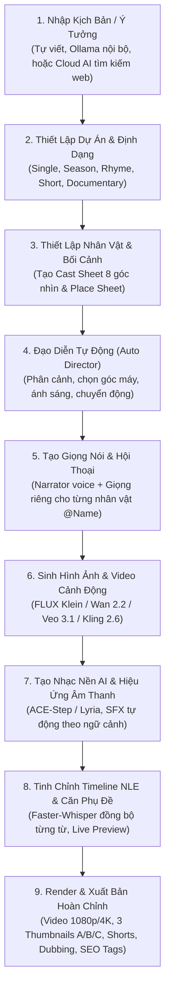

# BÁO CÁO PHÂN TÍCH TOÀN DIỆN VỀ PHẦN MỀM OMNITUBE (Phiên bản 1.5.0)

> **Tệp phân tích:** `C:\Users\Admin\Downloads\OMNITUBE_Setup_1.5.0.exe`  
> **Nhà phát triển:** Haris Ai  
> **Phiên bản:** 1.5.0 (Cập nhật tháng 11/2026)  
> **Đối tượng người dùng:** Nhà sáng tạo nội dung YouTube, nhà sản xuất video Faceless (không lộ mặt), Storyteller, Kênh Phim tài liệu, Kênh Truyện thiếu nhi / Thư giãn, và Agency sản xuất nội dung số.

---

## MỤC LỤC
1. [Tổng Quan & Định Vị Sản Phẩm](#1-tổng-quan--định-vị-sản-phẩm)
2. [Kiến Trúc Kỹ Thuật & Công Nghệ Lõi](#2-kiến-trúc-kỹ-thuật--công-nghệ-lõi)
3. [Bảng So Sánh Chi Tiết: Bản Miễn Phí (Free) vs Nâng Cao (Pro)](#3-bảng-so-sánh-chi-tiết-bản-miễn-phí-free-vs-nâng-cao-pro)
4. [Quy Trình Hoạt Động Khép Kín (End-to-End Workflow)](#4-quy-trình-hoạt-động-khép-kín-end-to-end-workflow)
5. [Phân Tích Chi Tiết Toàn Bộ Tính Năng & Phân Hệ](#5-phân-tích-chi-tiết-toàn-bộ-tính-năng--phân-hệ)
   - [5.1. Soạn Thảo & Định Dạng Kịch Bản Thông Minh (Script Engine)](#51-soạn-thảo--định-dạng-kịch-bản-thông-minh-script-engine)
   - [5.2. Đồng Bộ Nhân Vật & Bối Cảnh (Cast & Places Consistency Studio)](#52-đồng-bộ-nhân-vật--bối-cảnh-cast--places-consistency-studio)
   - [5.3. Tạo Hình Ảnh & Phong Cách Nghệ Thuật (Look & Styles)](#53-tạo-hình-ảnh--phong-cách-nghệ-thuật-look--styles)
   - [5.4. Đạo Diễn Ảo & Chuyển Động Video (Storyboard & Image-to-Video)](#54-đạo-diễn-ảo--chuyển-động-video-storyboard--image-to-video)
   - [5.5. Studio Lồng Tiếng, Âm Nhạc & Hiệu Ứng Âm Thanh (Audio Studio)](#55-studio-lồng-tiếng-âm-nhạc--hiệu-ứng-âm-thanh-audio-studio)
   - [5.6. Phim Tài Liệu Đỉnh Cao (Documentary Studio) & 21 Kênh Mẫu](#56-phim-tài-liệu-đỉnh-cao-documentary-studio--21-kênh-mẫu)
   - [5.7. Hệ Thống Đồ Họa Động 20 Mẫu (Motion Graphics Engine)](#57-hệ-thống-đồ-họa-động-20-mẫu-motion-graphics-engine)
   - [5.8. Trình Dựng Video Phi Tuyến Tính (Timeline Editor - NLE)](#58-trình-dựng-video-phi-tuyến-tính-timeline-editor---nle)
   - [5.9. Hậu Kỳ, Đóng Gói YouTube, Shorts & Lồng Tiếng Đa Ngôn Ngữ](#59-hậu-kỳ-đóng-gói-youtube-shorts--lồng-tiếng-đa-ngôn-ngữ)
   - [5.10. Điều Khiển Qua Trợ Lý AI: Giao Thức MCP (Model Context Protocol)](#510-điều-khiển-qua-trợ-lý-ai-giao-thức-mcp-model-context-protocol)
   - [5.11. Quản Lý Hệ Thống & Tối Ưu Phần Cứng (Setup Center)](#511-quản-lý-hệ-thống--tối-ưu-phần-cứng-setup-center)
6. [Yêu Cầu Phần Cứng & Khả Năng Tương Thích](#6-yêu-cầu-phần-cứng--khả-năng-tương-thích)
7. [Đánh Giá Ưu Điểm, Nhược Điểm & Kết Luận](#7-đánh-giá-ưu-điểm-nhược-điểm--kết-luận)

---

## 1. TỔNG QUAN & ĐỊNH VỊ SẢN PHẨM

**OMNITUBE** là nền tảng máy tính để bàn (Desktop Studio) sản xuất video tự động hóa hoàn chỉnh ứng dụng Trí tuệ Nhân tạo thế hệ mới (Local & Hybrid AI Video Engine).

Khẩu hiệu cốt lõi của phần mềm là:
> *"Script in, finished YouTube video out (voice, images, video scenes, music, thumbnail, title, description and tags). Runs on your own PC, no subscription."*  
> *(Chỉ cần đưa kịch bản vào, nhận video YouTube hoàn chỉnh xuất ra gồm: giọng đọc, hình ảnh, phân cảnh video chuyển động, nhạc nền bản quyền, ảnh đại diện thumbnail, tiêu đề, mô tả và thẻ tags. Chạy trên chính máy tính của bạn, hoàn toàn không cần gói đăng ký thuê bao).*

### Điểm đột phá của OMNITUBE so với các công cụ web thông thường:
1. **Chạy hoàn toàn cục bộ (100% Offline/Local) hoặc Kết hợp Đám mây (Hybrid Cloud)**: Không phụ thuộc vào máy chủ trung gian, không bị giới hạn số phút tạo video, không gắn watermark (hình mờ).
2. **Không bán Credits (Tín dụng ảo)**: Người dùng bản Pro tự kết nối API Key của các nhà cung cấp AI lớn (Google, OpenAI, Anthropic, ElevenLabs, OpenRouter, fal.ai, Higgsfield). Người dùng trả phí trực tiếp cho nhà cung cấp theo biểu giá gốc không bị kê giá hay ăn chênh lệch.
3. **Tính nhất quán hình ảnh nhân vật & bối cảnh (Consistency Engine)**: Giải quyết vấn đề lớn nhất của video AI hiện nay là nhân vật bị biến dạng hoặc thay đổi mặt sau mỗi cảnh quay thông qua bảng tham chiếu (Cast Sheet 8 góc nhìn & Place Sheet).
4. **Quy trình sản xuất khép kín toàn diện**: Từ nghiên cứu tài liệu, xác thực sự thật (Fact-check), viết kịch bản, lồng tiếng đa nhân vật, sinh hình ảnh, chuyển ảnh thành clip video động (I2V), tạo nhạc nền theo nhịp, căn chỉnh phụ đề theo từng từ, tạo ảnh bìa A/B/C, cắt Shorts tự động, lồng tiếng quốc tế 18 ngôn ngữ, đến đăng tải tự động lên YouTube / TikTok / Reels.

---

## 2. KIẾN TRÚC KỸ THUẬT & CÔNG NGHỆ LÕI

Dựa trên cấu trúc tệp trích xuất từ bộ cài `OMNITUBE_Setup_1.5.0.exe`, kiến trúc kỹ thuật của phần mềm bao gồm:

| Thành phần | Công nghệ / Thư viện được triển khai | Vai trò & Đặc tính |
|---|---|---|
| **Bộ cài đặt** | Inno Setup 6.7.0 (Unicode, lzma2 compression) | Đóng gói cài đặt 64-bit nhẹ (~40.5MB), cấu hình khởi động tự động. |
| **Lõi ứng dụng (Core)** | Cython / C-Extension (`app.cp312-win_amd64.pyd`) | Mã nguồn backend Python 3.12 được biên dịch sang mã máy C/C++ nhằm bảo vệ bản quyền và đạt hiệu năng tối đa. |
| **Web Server nội bộ** | FastAPI + Uvicorn | Chạy API cục bộ tốc độ cao tại cổng `http://127.0.0.1:7860`. |
| **Giao diện Người dùng (UI)** | `pywebview >= 5.4` + Microsoft Edge WebView2 | Giao diện hiện đại viết bằng HTML5/CSS3/Vanilla JS, không tốn tài nguyên như Electron cồng kềnh. |
| **Quản lý Môi trường Python** | Astral `uv.exe` (`runtime\uv.exe`) | Công cụ quản lý package và virtual environment nhanh gấp 10-100 lần pip thông thường. |
| **Nền tảng Học sâu (DL Engine)** | PyTorch 2.8.0 + CUDA 12.8 (`cu128`) | Hỗ trợ toàn bộ dòng card NVIDIA RTX từ RTX 20 series, 30 series, 40 series đến thế hệ mới nhất **RTX 50 series (Blackwell)**. |
| **Sinh Hình ảnh & Video** | ComfyUI Engine tích hợp sẵn hoặc liên kết ngoài | Chạy các pipeline ComfyUI tiên tiến nhất qua API JSON. |
| **Mô hình Sinh Hình ảnh** | **FLUX.2 Klein 4B** & **FLUX.1 Schnell** | Mô hình khuếch tán hình ảnh thế hệ mới, sinh ảnh sắc nét, giữ nhân vật ổn định qua các workflow tham chiếu `klein_ref_api.json`. |
| **Mô hình Sinh Video Clip** | **Wan 2.2 5B** & **Wan 2.2 14B FAST** | Mô hình Image-to-Video (I2V) tạo chuyển động máy quay và nhân vật tự nhiên 5 giây/cảnh. |
| **Mô hình Tạo Nhạc AI** | **ACE-Step 3.5B** (`ace_step_music_api.json`) | Sinh nhạc nền bản quyền sạch chuẩn YouTube theo tâm trạng từng chương. |
| **Mô hình Giọng nói (TTS)** | Kokoro TTS, Chatterbox Turbo, Edge-TTS | Bộ ba động cơ giọng nói chất lượng cao, hỗ trợ nhân bản giọng (Voice Cloning) từ đoạn thu 10-30s. |
| **Căn chỉnh Phụ đề (STT/Alignment)** | `faster-whisper >= 1.0` | Nhận diện giọng nói để gắn timestamp chính xác từng từ cho phụ đề động. |
| **Xử lý Âm thanh & Video** | FFmpeg, OpenCV, Pillow, Librosa, Scipy, Pyloudnorm | Chuẩn hóa âm lượng (EBU R128 loudness), ghép âm thanh, lọc nhiễu, render video chất lượng cao. |
| **Giao thức Điều khiển Ngoài** | Model Context Protocol (MCP) (`omnitube_mcp.py`) | Cho phép kết nối và điều khiển trực tiếp từ Claude Desktop hoặc Claude Code. |

---

## 3. BẢNG SO SÁNH CHI TIẾT: BẢN MIỄN PHÍ (FREE) VS NÂNG CAO (PRO)

| Tiêu chí | Bản Miễn Phí (Free - On my PC) | Bản Nâng Cao (Pro - Cloud & Studio) |
|---|---|---|
| **Chi phí phần mềm** | Miễn phí trọn đời, không quảng cáo, không watermark, không giới hạn độ dài video. | Mua giấy phép 1 lần (qua Gumroad). Không trả phí duy trì hàng tháng cho OMNITUBE. |
| **Nơi xử lý đồ họa** | Card đồ họa NVIDIA trên máy (GPU từ 4GB VRAM trở lên). | Trên máy hoặc trên Đám mây (Cloud) qua API Key của chính bạn. Máy yếu/Mac vẫn làm video khủng. |
| **Mô hình Tạo Hình ảnh** | FLUX.2 Klein 4B, FLUX.1 Schnell chạy trên GPU cục bộ. | Seedream, Nano Banana, Grok Image 2, FLUX Cloud (chi phí cực rẻ ~0.01$ - 0.03$/ảnh). |
| **Mô hình Chuyển động Video** | Wan 2.2 (5B hoặc 14B FAST) qua ComfyUI cục bộ. | Google Veo 3.1, Veo 3.1 Lite, Kling 2.6 (chất lượng điện ảnh). |
| **Động cơ Giọng nói (TTS)** | Kokoro (Anh, Tây Ban Nha, Pháp, Ý, Hindi, Bồ Đào Nha), Chatterbox Turbo (giọng tự nhiên, clone giọng), Microsoft Edge voices. | Thêm ElevenLabs (thư viện 20.000+ giọng, clone chuyên nghiệp), Google Gemini voices (70+ ngôn ngữ, diễn cảm), OpenAI, OpenRouter. |
| **Mô hình Tạo Nhạc** | ACE-Step 3.5B tạo nhạc AI trực tiếp trên GPU. | Bổ sung Google Lyria và ElevenLabs Music. |
| **Đồng bộ Môi (Lip Sync)** | Không hỗ trợ trên bản Free. | Có (tích hợp fal.ai đồng bộ chuyển động môi nhân vật khớp với giọng nói). |
| **Trình dựng Timeline (NLE)** | Chỉ xem Storyboard tuần tự. | Mở khóa **Timeline Editor đa rãnh** chuẩn Premiere (preview trực tiếp, kéo thả âm thanh, cắt cúp cảnh). |
| **Phim Tài Liệu (Documentary Studio)** | Không có. | Mở khóa **Documentary Studio** chuyên nghiệp, quét ảnh/clip miễn phí (NASA, Wikimedia) & Motion Graphics. |
| **Viết Kịch bản AI** | Viết kịch bản qua Ollama cục bộ (Smart Director). | Tích hợp Cloud Script AI với tìm kiếm web trực tiếp (OpenRouter, Claude, GPT-4o, DeepSeek, Grok). |
| **Xuất Bản & Độ Phân Giải** | Xuất chuẩn Full HD 1080p. | Mở khóa **Xuất 4K Master siêu nét**, đóng Watermark logo kênh, Đăng tải tự động lên YouTube / TikTok / Reels qua Upload-Post. |
| **Điều khiển từ Claude** | Chỉ hỗ trợ lệnh xem trạng thái (`status`, `script_guide`). | Điều khiển toàn bộ quy trình làm video qua Claude Desktop / Claude Code bằng giao thức MCP. |

---

## 4. QUY TRÌNH HOẠT ĐỘNG KHÉP KÍN (END-TO-END WORKFLOW)

Quy trình hiển thị trên giao diện theo từng nấc rõ ràng:
1. **1 · Voice** (Ghi âm giọng dẫn và nhân vật)
2. **2 · Images** (Sinh toàn bộ tranh ảnh cảnh quay)
3. **3 · Videos** (Chuyển ảnh thành clip video động đối với các cảnh hành động hoặc Hook mở đầu)
4. **4 · Render** (Ghép hình ảnh, video, âm thanh, nhạc nền, color grading, phụ đề)
5. **5 · Export** (Xuất tệp video, sinh ảnh bìa thumbnail, bộ từ khóa thẻ tags, tạo video Shorts ngắn và bản dịch tiếng nước ngoài)

---

## 5. PHÂN TÍCH CHI TIẾT TOÀN BỘ TÍNH NĂNG & PHÂN HỆ

### 5.1. Soạn Thảo & Định Dạng Kịch Bản Thông Minh (Script Engine)

OMNITUBE sử dụng hệ thống đánh dấu văn bản (Script Tagging) đơn giản nhưng cực kỳ mạnh mẽ:

| Thẻ kịch bản | Cú pháp mẫu | Tác dụng |
|---|---|---|
| **Chương** | `# Bình minh trên đỉnh núi` | Bắt đầu chương mới, hiển thị tiêu đề lớn trên video và đổi nhịp nhạc. |
| **Mô tả ảnh** | `[IMG: một ngôi nhà gỗ nhỏ ven hồ lúc hoàng hôn]` | Chỉ định trực tiếp nội dung tranh vẽ cho phân đoạn bên dưới. |
| **Định nghĩa nhân vật** | `[CAST: Nam = chàng trai 25 tuổi, tóc đen ngắn, áo khoác bò xanh]` | Thiết lập nhân vật nhất quán, giữ nguyên ngoại hình qua mọi cảnh. |
| **Định nghĩa bối cảnh** | `[PLACE: PhongKhach = căn phòng ấm cúng, sofa da nâu, lò sưởi bập bùng]` | Cố định nội thất, màu tường và ánh sáng cho mọi cảnh tại phòng khách. |
| **Hội thoại nhân vật** | `@Nam: Cậu có chắc muốn đi vào khu rừng đó không?` | Dòng thoại riêng biệt do chính nhân vật nói bằng chất giọng được chỉ định riêng. |
| **Đưa nhân vật vào ảnh** | `[IMG: @Nam đang đứng nhìn ra cửa sổ tại @PhongKhach]` | Tự động ghép đúng nhân vật Nam vào đúng căn phòng khách đã thiết lập. |
| **Tiêu đề & Ảnh bìa** | `[TITLE: ...]`, `[THUMBNAIL: ...]` | Thiết lập trước tiêu đề video và chữ nổi trên ảnh bìa. |

#### Các công cụ bổ trợ kịch bản:
- **Hook Doctor**: Tự động chấm điểm 30 giây đầu tiên của video trên thang điểm 10 và gợi ý các câu mở đầu lôi cuốn hơn nhằm giữ chân người xem.
- **Originality Check**: So sánh kịch bản với các video trước đó trong thư viện để đảm bảo nội dung không bị trùng lặp, phòng ngừa việc YouTube từ chối bật kiếm tiền vì lỗi "nội dung sản xuất hàng loạt".
- **Explainer Cuts**: Chế độ chuyển cảnh nhanh (3 giây/cảnh, kết hợp chữ số viết tay phong cách vẽ phác thảo Stick).
- **Batch Processing**: Nhập tối đa **200 kịch bản cùng lúc** qua tệp `.txt`, `.csv`, hoặc `.json` để phần mềm tự động sản xuất hàng loạt qua đêm.

---

### 5.2. Đồng Bộ Nhân Vật & Bối Cảnh (Cast & Places Consistency Studio)

Đây là tính năng giá trị bậc nhất của OMNITUBE, giải quyết triệt để lỗi AI "mỗi cảnh vẽ một mặt khác nhau":

1. **Character Studio (Cast Tab)**:
   - Tự động tạo **Bảng tạo hình 8 góc nhìn (8-view character sheet)**: mặt chính diện, góc nghiêng 45 độ, góc nhìn bên, biểu cảm vui, buồn, ngạc nhiên...
   - **Photo Upload & Face Geometry**: Người dùng có thể tải lên một bức ảnh chân dung thật; AI sẽ phân tích hình học khuôn mặt để vẽ nhân vật hoạt hình hoặc điện ảnh giữ nguyên cấu trúc mặt đó.
   - **Life Stage**: Hỗ trợ mở rộng nhân vật ở các độ tuổi khác nhau (ví dụ: nhân vật lúc 10 tuổi, 25 tuổi, và khi về già).
   - **Shared Season Library**: Khi sản xuất phim bộ nhiều tập (Seasons), dàn nhân vật chỉ cần tạo một lần và được dùng chung cho tất cả các tập tiếp theo.
2. **Scene Sheets (Places Tab)**:
   - Tạo bảng mẫu cho không gian trong nhà (Indoor) và ngoài trời (Outdoor).
   - Đảm bảo từ góc máy rộng, góc máy cận đến góc máy chéo đều có chung màu sơn tường, vị trí đồ đạc và nguồn sáng.

---

### 5.3. Tạo Hình Ảnh & Phong Cách Nghệ Thuật (Look & Styles)

OMNITUBE tích hợp hơn 30 bộ phong cách mỹ thuật dựng sẵn, được tinh chỉnh prompt tối ưu:
- **Anime & Manga**: Anime Classic, Anime Cinematic, Anime Dark, Anime Soft, Chibi, Manga.
- **3D & Hoạt hình**: Pixar 3D, Soft 3D, Claymation (đất sét), Cartoon, Lowpoly, Stick Animation.
- **Điện ảnh & Thực tế**: Cinematic Realistic, Film Noir, Vintage, Documentary, Horror Realistic, Found Footage.
- **Mỹ thuật Cổ điển & Đương đại**: Ukiyo-e (tranh khắc gỗ Nhật Bản), Tranh sơn dầu (Oil painting), Màu nước (Watercolor), Phù điêu (Engraving), Tranh kính màu (Stained Glass), Cyberpunk Neon, Synthwave, Dark Fantasy, Papercut (nghệ thuật cắt giấy).

#### Tính năng "My Styles" (Tạo phong cách độc quyền):
Người dùng chỉ cần tải lên từ 1 đến 6 bức ảnh mẫu bất kỳ (ảnh phim, tranh vẽ cá nhân). AI sẽ "đọc" phong cách màu sắc, nét cọ, ánh sáng và áp dụng phong cách độc quyền đó cho toàn bộ các video tiếp theo.

#### Hậu kỳ hình ảnh tích hợp:
- **Body Check (Sửa lỗi hình thể AI)**: AI tự quét lại tay chân, ngón tay của nhân vật; nếu phát hiện bị biến dạng sẽ tự động vẽ lại.
- **Color Grading & Cinematic Bars**: Bộ lọc màu điện ảnh tự động, hiệu ứng hạt phim (Film grain), làm tối góc (Vignette), và vạch đen điện ảnh tỉ lệ 21:9.

---

### 5.4. Đạo Diễn Ảo & Chuyển Động Video (Storyboard & Image-to-Video)

Phân hệ **Storyboard** hoạt động như một bàn đạo diễn điện ảnh ảo:
- **Auto Director**: Tự động tính toán để mỗi cảnh có góc máy khác nhau (Góc toàn Wide shot, Cận cảnh Close-up, Góc thấp Low angle, Góc cao High angle, Ánh sáng ngược Backlight...).
- **Shot Builder & 46 Kiểu Chuyển Động Máy Quay**: Hỗ trợ Dolly in/out, Pan trái/phải, Tilt lên/xuống, Orbit quay vòng, FPV flythrough...
- **Pacing Control (Điều tiết nhịp độ & tiết kiệm chi phí)**:
  - *Fast*: Mỗi câu thoại tạo 1 tranh mới 100%.
  - *Normal*: Cảnh kế tiếp lấy góc cận (Close-up) hoặc lia máy từ ảnh trước (giảm 50% chi phí tạo ảnh).
  - *Calm*: Dùng 1 bức ảnh cho 3 phân đoạn bằng cách đổi vị trí camera (giảm 67% chi phí, cực kỳ phù hợp cho video lịch sử, bedtime story, podcast).
- **Animate The Hook**: Cho phép người dùng chọn chỉ chuyển ảnh thành video động ở 1-3 phút đầu tiên (đoạn Hook giữ chân khán giả), các đoạn sau dùng ảnh tĩnh lia máy nhẹ để tối ưu thời gian render và chi phí.
- **Lip Sync (Khớp khẩu hình)**: Tự động phân tích giọng nói của nhân vật và làm chuyển động môi khớp từng âm tiết thông qua fal.ai.

---

### 5.5. Studio Lồng Tiếng, Âm Nhạc & Hiệu Ứng Âm Thanh (Audio Studio)

Hệ thống âm thanh của OMNITUBE là một tổ hợp âm thanh phòng thu hoàn chỉnh:

1. **Hệ thống Giọng đọc (Voice System)**:
   - **Kokoro TTS (Offline)**: Tốc độ cực nhanh, đọc mượt tiếng Anh, Tây Ban Nha, Pháp, Ý, Bồ Đào Nha, Hindi.
   - **Chatterbox Turbo (Offline)**: Giọng đọc tự nhiên như người thật; hỗ trợ nhân bản giọng đọc cá nhân chỉ từ 1 file mẫu 10 - 30 giây.
   - **Microsoft Edge TTS (Free Online)**: Đầy đủ các vùng miền tiếng Anh, Urdu, Hindi, Ả Rập, Đức, Pháp... Tự động chuyển đổi dự phòng (Fallback) sang Kokoro nếu mất kết nối internet.
   - **Cloud Studio Voices (Pro)**: Google Gemini Voice (hỗ trợ mô tả phong cách diễn đạt: thì thầm, kịch tính, tin tức, ma mị), ElevenLabs (hơn 20.000 giọng lồng tiếng Hollywood).
2. **Xử lý Phòng thu (Voice Studio & Studio Clean)**:
   - Tự động khử tiếng xì ("s" sounds), lọc tạp âm nền, chuẩn hóa mức âm lượng bằng thuật toán `pyloudnorm`.
   - Các hiệu ứng âm thanh đặc biệt: Tiếng vang hội trường (Hall Echo), Thì thầm ASMR, Giọng radio cổ (Old Radio), Giọng trailer phim kinh dị.
3. **Tạo Nhạc Nền AI (AI Music Engine)**:
   - Mô hình **ACE-Step 3.5B** chạy trên GPU tự sáng tác các đoạn nhạc nền không đụng hàng, không bị YouTube bắt bản quyền Content ID.
   - **Dynamic Audio Ducking**: Tự động giảm âm lượng nhạc xuống 10-15% khi có giọng đọc và đẩy lớn lên ở các khoảng nghỉ.
   - **Needle Drops**: Tự động ngắt tiếng nhạc đột ngột tại các khoảnh khắc kịch tính/bất ngờ để tạo điểm nhấn cảm xúc.
4. **Hiệu ứng Âm thanh (Sound Effects - SFX)**:
   - Tự động nhận diện từ khóa trong kịch bản (tiếng sấm chớp, tiếng gõ cửa, tiếng bước chân, tiếng mở sách) và chèn âm thanh tương ứng từ thư viện nội bộ hoặc sinh âm thanh AI qua ElevenLabs.

---

### 5.6. Phim Tài Liệu Đỉnh Cao (Documentary Studio) & 21 Kênh Mẫu

Phân hệ **Documentary Studio** được thiết kế riêng cho các kênh làm phim tài liệu điều tra, lịch sử, khoa học, kinh tế, phân tích chuyên sâu:

#### 2 Chế độ làm việc:
1. **From a Topic (Từ một chủ đề bất kỳ)**:
   - AI tự động truy cập internet để tìm kiếm tư liệu lịch sử, số liệu.
   - Kiểm chứng chéo sự thật: Phân loại thông tin thành *Đã xác thực bởi 2+ trang web*, *Bách khoa toàn thư Wikipedia*, *Chỉ 1 nguồn*, hoặc *Đang tranh cãi (Disputed)*.
   - Tự động tìm kiếm tranh ảnh, bản đồ, video tư liệu bản quyền tự do từ kho lưu trữ **Wikimedia Commons** và **NASA**, tự động lọc bỏ các ảnh có bản quyền thương mại.
2. **From My Folder (Từ thư mục cá nhân)**:
   - Quét toàn bộ video, ảnh chụp, ghi âm chuyến đi hoặc tài liệu nghiên cứu của người dùng, tự hiểu nội dung và viết kịch bản dẫn chuyện liền mạch.

#### Mô phỏng 21 Phong cách Kênh YouTube Hàng đầu:
OMNITUBE tích hợp sẵn mẫu phong cách nghệ thuật và nhịp dựng của 21 kênh YouTube tài liệu nổi tiếng thế giới:
1. **Johnny Harris (Jani)**: Bản đồ hoạt họa, tài liệu giấy báo đánh dấu bút nhớ, góc quay zoom kịch tính.
2. **Bobby Broccoli**: Dòng thời gian cuộn, đồ họa dữ liệu khoa học, nhạc nền jazz bí ẩn.
3. **Fern**: Phân tích địa chính trị, giao diện tối màu, typography hiện đại.
4. **Mustard**: Bản vẽ kỹ thuật máy bay/tàu thủy (Blueprints), bảng thông số chi tiết.
5. **Neo**: Đồ họa vi tính HUD, phân tích đô thị, định vị vệ tinh.
6. **Nitish Rajput**: Phân tích tài liệu điều tra, bong bóng hội thoại trích dẫn phát ngôn, thẻ dẫn nguồn tin cậy.
7. **The Space Race / Primal Space**: Khám phá vũ trụ, vòng tròn khoanh vùng viết tay.
8. **Engineering Impossible**: Bảng thông số cơ khí, mặt cắt công trình.
9. **Yarnhub / Pezle / Atrium / BluePawPrint / Empire Files / So Basically...**

---

### 5.7. Hệ Thống Đồ Họa Động 20 Mẫu (Motion Graphics Engine)

Được viết bằng HTML5/CSS3/Canvas chuyên dụng (`assets\mograph\graphics.html`), OMNITUBE render các lớp đồ họa chuyển động chuẩn đài truyền hình ở độ phân giải 1920x1080 (hoặc 4K):

| STT | Tên hiệu ứng đồ họa | Mô tả hiển thị |
|---|---|---|
| 1 | **T.label (Lower-third)** | Bảng tên nhân vật, chức vụ, thanh màu chuyển động (kiểu tag, line, hud). |
| 2 | **T.year (Year Stamp)** | Dãy chữ số năm phóng to, từng chữ số cuộn vào kèm gạch chân và chú thích. |
| 3 | **T.number (Number Counter)** | Bộ đếm số tự động nhảy từ 0 đến con số thực tế (có tiền tố $, hậu tố %, dấu thập phân). |
| 4 | **T.kinetic (Kinetic Typography)** | Chữ cái cỡ đại đập mạnh vào giữa khung hình kèm hiệu ứng rung màn hình (shake) và glitch. |
| 5 | **T.chapter (Chapter Card)** | Bảng mở đầu chương toàn màn hình, hiệu ứng lưới mờ và số thứ tự chương mờ sau nền. |
| 6 | **T.article (Torn Paper Clipping)** | Đoạn trích bài báo hoặc trang web xé mép giấy, có vệt bút dạ quang vàng (highlighter) tô đè lên từ khóa. |
| 7 | **T.quote (Quote Card)** | Khung trích dẫn danh ngôn trang trọng với dấu ngoặc kép lớn và tên tác giả. |
| 8 | **T.place (Place Pin)** | Kim ghim bản đồ rơi xuống vị trí tọa độ, vòng tròn sóng tỏa ra và tên địa danh tự gõ chữ. |
| 9 | **T.stamp (Typewriter Stamp)** | Dòng chữ máy đánh chữ cổ điển gõ từng ký tự kèm con trỏ nhấp nháy góc dưới màn hình. |
| 10 | **T.title (Video Title Opening)** | Tựa đề chính của video mở rộng từ từ ở khung cảnh mở đầu. |
| 11 | **T.newspaper (Newspaper Clipping)** | Trang báo in cổ điển (Daily Chronicle) với tiêu đề lớn 2 cột chữ và vệt dạ quang. |
| 12 | **T.board (Evidence Board)** | Bảng trinh thám/điều tra với các thẻ manh mối được nối với nhau bằng sợi chỉ đỏ. |
| 13 | **T.post (Social Media Post)** | Mô phỏng bài đăng mạng xã hội (Twitter / X / Reddit) với avatar, tên tài khoản, nội dung và lượt tương tác. |
| 14 | **T.hud (Sci-Fi HUD Callout)** | Vòng tròn khóa mục tiêu công nghệ cao với đường chỉ dẫn (leader line) nối vào bảng dữ liệu. |
| 15 | **T.spec (Blueprint Spec Sheet)** | Bảng thông số kỹ thuật nền xanh dạng lưới (Blueprint) với các hàng dữ liệu so sánh. |
| 16 | **T.circle (Hand-drawn Circle)** | Vòng tròn nét vẽ tay khoanh tròn điểm cần chú ý trên video kèm chữ viết tay. |
| 17 | **T.timeline (Horizontal Timeline)** | Trục thời gian nằm ngang có con trỏ trượt mượt mà đến năm xảy ra sự kiện. |
| 18 | **T.source (Citation Card)** | Thẻ dẫn nguồn tài liệu góc dưới màn hình nhằm tăng độ uy tín cho video. |
| 19 | **T.bubble (Speech Bubble)** | Bong bóng hội thoại truyện tranh bật ra từ nhân vật. |
| 20 | **T.transcript (Audio Log)** | Khung nhật ký ghi âm đen mờ gõ từng chữ theo lời khai của nhân chứng. |

---

### 5.8. Trình Dựng Video Phi Tuyến Tính (Timeline Editor - NLE)

Mở khóa trong phiên bản Pro, phân hệ Timeline biến OMNITUBE thành một phần mềm dựng phim tương tự Adobe Premiere Pro hay DaVinci Resolve ngay trong ứng dụng:
- **Hệ thống Track đa rãnh**:
  - `T1 Captions`: Rãnh phụ đề chữ động.
  - `V1 Pictures & Videos`: Rãnh hình ảnh và video clip nền.
  - `A1 Voice`: Rãnh giọng đọc thuyết minh và hội thoại.
  - `A2 Clip Audio`: Rãnh âm thanh gốc của video clip đưa vào.
  - `A3 SFX`: Rãnh tiếng động hiệu ứng.
  - `A4 Music`: Rãnh nhạc nền tự động hoặc nhạc tải lên.
- **Trình phát thời gian thực (Live Preview Monitor)**: Xem trực tiếp thay đổi tức thì mà không cần phải chờ render lại video.
- **Thao tác chuyên nghiệp**: Kéo giãn thời lượng giữ khung hình (Pause/Hold), cắt gọt clip, chỉnh sửa trực tiếp câu từ thoại, thay thế tranh ảnh bằng cách kéo thả tệp từ máy tính vào dòng thời gian.
- **Xuất file dự án dựng ngoài**: Hỗ trợ xuất tệp **XML cho Adobe Premiere Pro** (kèm toàn bộ audio stems tách rãnh) và tệp dự án nháp cho **CapCut**.

---

### 5.9. Hậu Kỳ, Đóng Gói YouTube, Shorts & Lồng Tiếng Đa Ngôn Ngữ

Sau khi video hoàn thành, tab **Output** cung cấp bộ công cụ tối ưu hóa kênh YouTube:

1. **Bộ Phụ Đề Tự Động (Captions & SRT)**:
   - Tạo phụ đề chữ nổi bật theo phong cách MrBeast / Alex Hormozi (tô màu chữ đang đọc, chữ hoa, hiệu ứng nảy).
   - Xuất tệp `subtitles.srt` chuẩn để tải lên YouTube Studio.
2. **Bộ 3 Ảnh Bìa (Thumbnails A/B/C)**:
   - Tự động tạo 3 biến thể ảnh thumbnail khác nhau (Thumbnail A, B, C) tỉ lệ 16:9 để người dùng đưa vào tính năng **"Thử nghiệm và So sánh" (Test & Compare A/B testing)** của YouTube nhằm tối ưu tỷ lệ nhấp chuột (CTR).
   - Tự tạo ảnh bìa dọc tỉ lệ 9:16 cho YouTube Shorts.
3. **Bộ Siêu Dữ Liệu SEO (SEO Metadata)**:
   - Gợi ý 3 phong cách tiêu đề video giật tít, hấp dẫn.
   - Viết sẵn nội dung mô tả video (Description) bao gồm tự động chia các mốc thời gian chương (Timestamps).
   - Sinh danh sách thẻ Tags chuẩn SEO trong giới hạn 500 ký tự của YouTube.
   - Tạo tệp tổng hợp `youtube_metadata.txt`.
4. **Tự Động Cắt Video Shorts (Auto Shorts Maker)**:
   - Chọn số lượng (3, 5, 7, 10 Shorts); AI sẽ tự động phân tích những phân đoạn kịch tính nhất của video dài để cắt thành các video ngắn dọc 9:16 hoàn chỉnh với phụ đề cỡ lớn, nhạc nền và ảnh bìa riêng.
5. **Lồng Tiếng Quốc Tế 18 Ngôn Ngữ (AI Dubbing)**:
   - Dịch toàn bộ kịch bản sang các ngôn ngữ lớn: Tây Ban Nha, Pháp, Đức, Bồ Đào Nha, Hindi, Ả Rập...
   - Sử dụng giọng đọc bản xứ giữ nguyên cảm xúc và tông giọng của người dẫn chuyện ban đầu.
   - Xuất ra tệp video riêng biệt, tệp âm thanh lồng tiếng riêng, phụ đề riêng và tiêu đề tương ứng cho từng ngôn ngữ.
6. **Đăng Tải Tự Động (Multi-Platform Auto Publish)**:
   - Tích hợp dịch vụ **Upload-Post** để lên lịch và đăng tải trực tiếp video cùng lúc lên **YouTube, TikTok, Instagram Reels, Facebook**.

---

### 5.10. Điều Khiển Qua Trợ Lý AI: Giao Thức MCP (Model Context Protocol)

OMNITUBE 1.5.0 là một trong những phần mềm đồ họa tiên phong tích hợp giao thức mở **Model Context Protocol (MCP)** do Anthropic khởi xướng:
- Tệp máy chủ: `{app}\assets\mcp\omnitube_mcp.py`.
- Cho phép người dùng kết nối OMNITUBE với **Claude Desktop** hoặc **Claude Code**.
- Người dùng chỉ cần trò chuyện với Claude bằng ngôn ngữ tự nhiên:
  - *"Claude ơi, hãy làm cho tôi một video 3 phút chủ đề Thám hiểm Kim Tự Tháp Ai Cập phong cách Cinematic, dùng giọng trầm ấm và bật phụ đề lên."*
  - *"Thêm một nhân vật tên là Minh, 30 tuổi, mặc đồ thám hiểm vào video vừa tạo."*
  - *"Ước tính chi phí và bắt đầu quá trình sản xuất trên máy của tôi."*
- Toàn bộ thao tác tạo dự án, viết kịch bản, thêm nhân vật, ước tính chi phí, gọi render đều được Claude thực thi tự động thông qua 12 công cụ MCP chuẩn hóa (`omnitube_create_video`, `omnitube_add_character`, `omnitube_build`...).

---

### 5.11. Quản Lý Hệ Thống & Tối Ưu Phần Cứng (Setup Center)

Tab **Setup Center** đóng vai trò là bảng điều khiển kỹ thuật toàn diện:
- **Auto Setup**: Tự động nhận diện cấu hình máy tính (CPU, GPU, RAM, dung lượng ổ đĩa) và tự động tải cài đặt các mô hình phù hợp nhất.
- **Tự động nhận diện ComfyUI có sẵn**: Nếu người dùng đã cài sẵn ComfyUI trên máy, OMNITUBE sẽ liên kết thẳng tới thư mục đó để dùng chung toàn bộ các model Checkpoint, LoRA có sẵn, không bao giờ tải trùng lặp gây tốn ổ cứng.
- **Model Doctor**: Công cụ chẩn đoán tệp model AI. Nếu xảy ra sự cố mất điện hoặc lỗi tải làm hỏng file weights (`.safetensors`), Model Doctor sẽ phát hiện và sửa chữa ngay lập tức.
- **Kiểm soát chi phí (The 20% Safety Stop)**: Khi sử dụng Cloud API ở bản Pro, phần mềm có cơ chế an toàn: nếu chi phí phát sinh vượt quá 20% so với dự tính ban đầu, tiến trình sẽ tự động tạm dừng để người dùng duyệt tiếp, ngăn chặn việc hao hụt tài khoản ngoài ý muốn.

---

## 6. YÊU CẦU PHẦN CỨNG & KHẢ NĂNG TƯƠNG THÍCH

### Chạy hoàn toàn trên máy (Bản Free / On my PC):
- **Hệ điều hành:** Windows 10 hoặc Windows 11 (64-bit).
- **Card đồ họa (Bắt buộc cho chạy Local):** Card NVIDIA GeForce RTX series (RTX 2060, 3060, 4060, 4070, 4080, 4090, 5080, 5090...).
  - *Tối thiểu:* 4 GB - 8 GB VRAM (chạy FLUX Klein và Wan 2.2 5B).
  - *Khuyến nghị:* 12 GB - 16 GB VRAM.
  - *Tối ưu nhất:* 24 GB VRAM (RTX 3090 / 4090).
- **Bộ nhớ RAM:** Tối thiểu 16 GB (khuyến nghị 32 GB RAM nếu muốn tạo các cảnh video động chuyển động phức tạp với Wan 14B FAST).
- **Ổ cứng:** Còn trống khoảng **60 GB - 80 GB** (ưu tiên ổ SSD NVMe tốc độ cao để tải và nạp các tệp trọng số AI lớn).

### Chạy kết hợp Đám mây (Bản Pro / Cloud Mode):
- **Hệ điều hành:** Windows 10/11 hoặc **macOS (Apple Silicon M1, M2, M3, M4)**.
- **Card đồ họa:** Bất kỳ card đồ họa nào (kể cả card onboard Intel/AMD, laptop văn phòng mỏng nhẹ).
- **Ổ cứng:** Chỉ cần khoảng **3.5 GB** để cài đặt bộ khung ứng dụng và công cụ render âm thanh, mọi tác vụ đồ họa nặng đều do cloud xử lý.

---

## 7. ĐÁNH GIÁ ƯU ĐIỂM, NHƯỢC ĐIỂM & KẾT LUẬN

### ƯU ĐIỂM NỔI BẬT:
1. **Quy trình A-to-Z hoàn chỉnh nhất hiện nay**: Hiếm có phần mềm nào trên thị trường kết hợp trọn vẹn từ viết kịch bản, vẽ tranh, tạo video, làm nhạc, lồng tiếng, gắn phụ đề đến đóng gói SEO YouTube và xuất bản trong một giao diện duy nhất.
2. **Quyền riêng tư & Làm chủ 100%**: Bản miễn phí chạy offline hoàn toàn trên máy tính cá nhân, không lo lộ kịch bản hay ý tưởng độc quyền.
3. **Mô hình kinh doanh minh bạch, tôn trọng người dùng**: Bản Pro không áp dụng gói thuê bao định kỳ (subscription) và không bán credit giá đắt; người dùng dùng API Key trực tiếp với giá gốc rẻ hơn hàng chục lần so với các nền tảng web tạo video AI trung gian.
4. **Giải quyết xuất sắc bài toán nhân vật nhất quán (Consistency)**: Nhờ có Cast Sheet 8 góc độ và Places Sheet, các video hoạt hình, phim ngắn kể chuyện có độ tin cậy và chuyên nghiệp rất cao.
5. **Tích hợp sẵn các phong cách làm video triệu view**: 21 phong cách kênh tài liệu hàng đầu và 20 mẫu đồ họa động tích hợp giúp kênh video đạt tiêu chuẩn thẩm mỹ cao ngay từ đầu.
6. **Mở rộng tương lai qua MCP**: Khả năng ra lệnh trực tiếp từ Claude mở ra kỷ nguyên tự động hóa sản xuất nội dung quy mô lớn.

### NHƯỢC ĐIỂM & ĐIỂM CẦN LƯU Ý:
1. **Dung lượng tải ban đầu lớn (đối với bản Local)**: Cần tải khoảng 40GB - 80GB các mô hình AI mã nguồn mở (FLUX, Wan, PyTorch, ACE-Step, Ollama) nên yêu cầu đường truyền internet mạnh ở lần thiết lập đầu tiên.
2. **Đòi hỏi phần cứng GPU mạnh nếu không dùng Cloud**: Để trải nghiệm mượt mà khi chạy local, người dùng bắt buộc phải sở hữu máy tính có card NVIDIA RTX từ 8GB VRAM trở lên.
3. **Giao diện hiện tại bằng tiếng Anh**: Chưa tích hợp đa ngôn ngữ cho menu điều khiển (mặc dù kịch bản, giọng đọc và phụ đề hỗ trợ đầy đủ tiếng Việt và các ngôn ngữ khác).

---

### KẾT LUẬN

**OMNITUBE 1.5.0** là một "cỗ máy sản xuất nội dung số" thực thụ, một bước tiến vượt bậc trong lĩnh vực AI Video Generation dành cho các nhà sáng tạo nội dung YouTube và mạng xã hội. 

Dù bạn là một YouTuber cá nhân làm video không lộ mặt (Faceless Channel), một biên kịch muốn làm phim hoạt hình nhiều tập, hay một nhà sản xuất nội dung tài liệu lịch sử / khoa học chuyên nghiệp, OMNITUBE đều cung cấp đầy đủ mọi công cụ cần thiết từ A đến Z, giúp rút ngắn thời gian sản xuất từ nhiều ngày xuống chỉ còn vài chục phút với chất lượng hoàn thiện chuẩn phát sóng.

